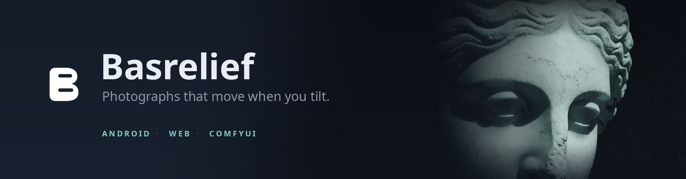
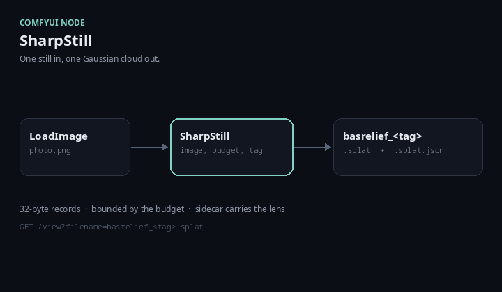
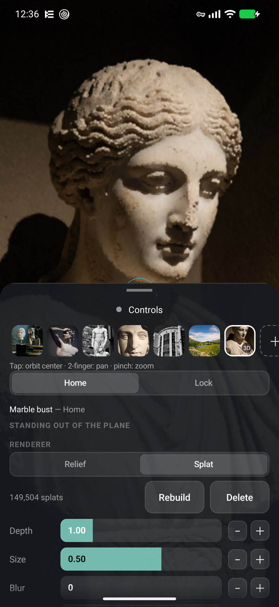
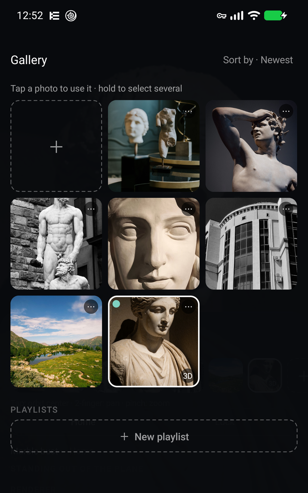
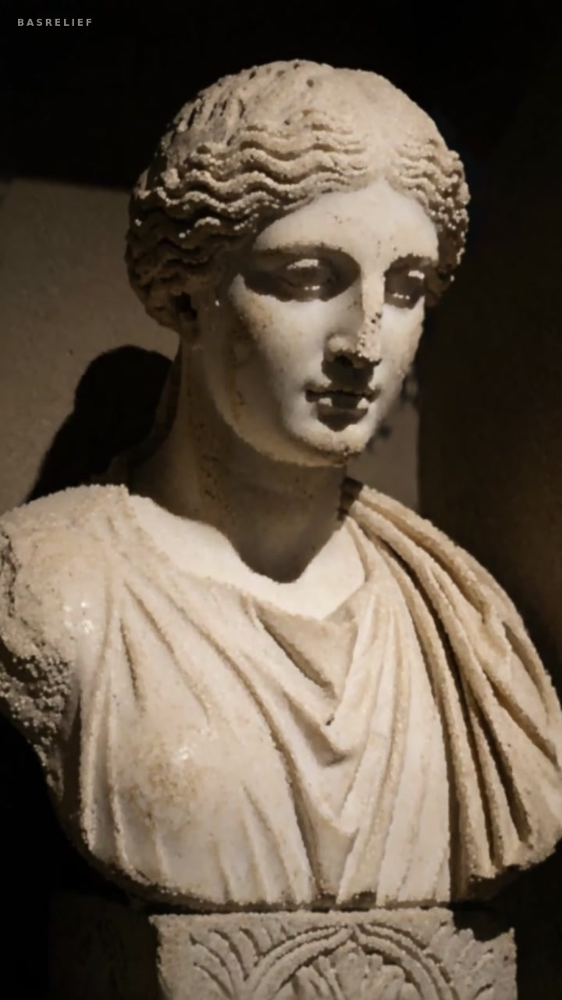
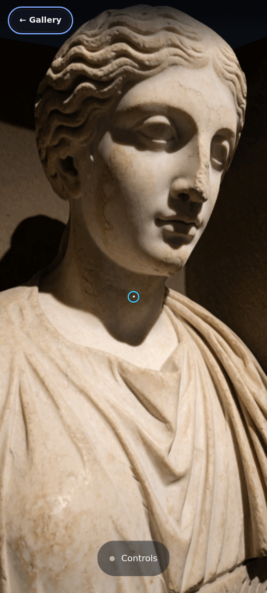
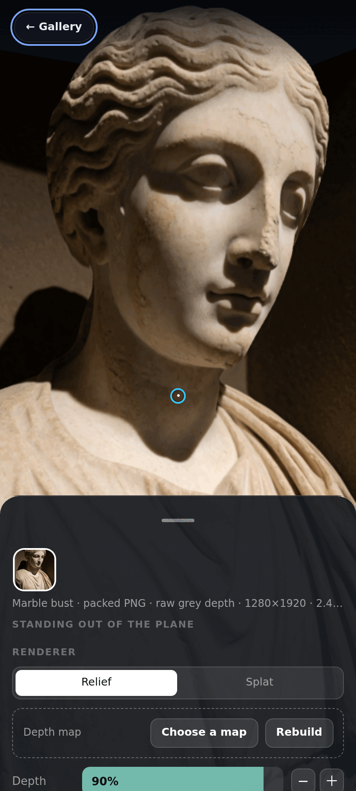
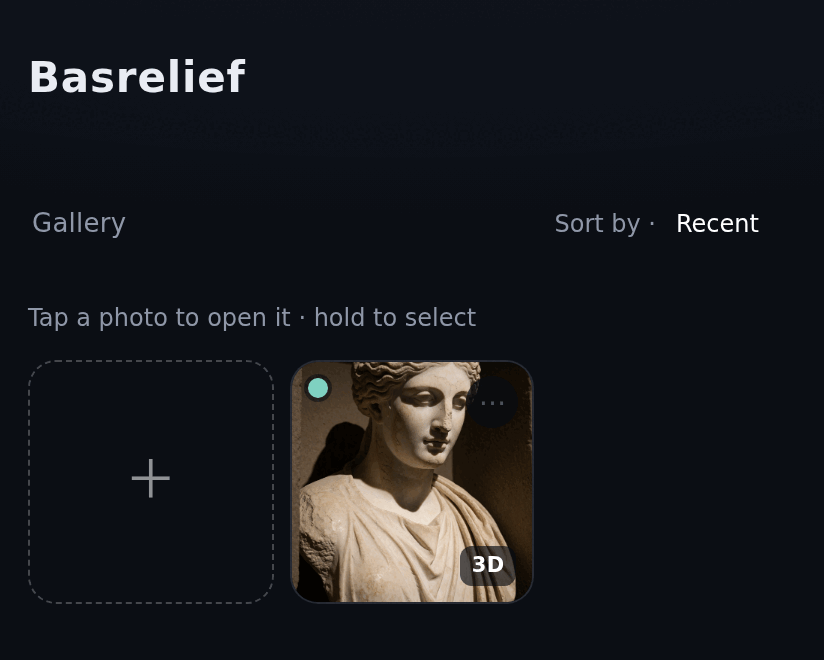

<p align="center">
  
</p>

<p align="center">
  <b>Android live wallpaper</b> · <b>browser gallery</b> · <b>ComfyUI node</b>
</p>

<p align="center">
  <a href="https://amoshydra.github.io/basrelief/"><b>Open the gallery</b></a> ·
  <a href="https://github.com/amoshydra/basrelief/releases/latest">Download the APK</a> ·
  <a href="server/comfy-node/basrelief_depth/README.md">Install the ComfyUI node</a>
</p>

<p align="center">
  <a href="https://github.com/amoshydra/basrelief/actions/workflows/build.yml"></a>
  <a href="https://github.com/amoshydra/basrelief/releases/latest"></a>
  <a href="LICENSE"></a>
</p>

Basrelief turns one photograph and its depth map into a surface you can move.
Tilt the phone and the picture swings around the point you touched; with a
Gaussian-splat cloud it has real volume. The same files open on the phone and in
the browser, and either one can ask your own ComfyUI server to build the depth
or the cloud.

It ships as three parts, and this repository is all three.

## Three parts

### Android — the live wallpaper

A live wallpaper and a studio in one app. The wallpaper follows the gallery's
selection and moves with the phone's gyro; the studio is where you open files,
tune the look, build a depth map or a cloud, and set the wallpaper. The studio
and the wallpaper share one camera model and one settings index, so a photo
tuned in the studio is the photo on the home screen.

[android/](android/) — Java and OpenGL ES, no AndroidX and no Maven
dependencies. The maths and persistence live in `:core`, a pure-JVM module with
no `android.*` imports, so the camera and library logic can be tested without a
device.

Install the signed APK from [Releases](https://github.com/amoshydra/basrelief/releases/latest);
[Obtainium](https://github.com/ImranR98/Obtainium) tracks the tag.

### Web — the gallery

A static Vite + TypeScript page that opens the app's own file formats. In the
gallery, drag a packed PNG or a `.splat` anywhere onto the page, or use the
**＋ Add photos** tile at the start of the grid. A packed PNG becomes a relief; a
`.splat` becomes a cloud. A lone `.splat` is session-only (the library needs a
poster photograph); pair it with a photo to keep it. The library is saved in the
browser (OPFS) — no account, no server, no cloud library — and the page mirrors
the studio's sheet.

[web/](web/) — [open the gallery](https://amoshydra.github.io/basrelief/), or
run it locally with `pnpm dev`. For a local ComfyUI, use the dev server's
`/comfy` proxy; a public HTTPS page cannot reach `localhost` directly.

### ComfyUI — the generator

ComfyUI is optional: the app and gallery open existing files without it. Use it
when you want a server you run to generate a new depth map or cloud. A depth node
the server exposes (MoGe, Depth Anything) can make a still depth map; this
repository adds the nodes that write the assets the renderers want:

- `SharpStill` — one still to a budgeted Gaussian cloud (`.splat` + sidecar).
- `MoGeVideoStream` — a video range to depth and normal clips (the app's clip
  import).

[server/comfy-node/basrelief_depth](server/comfy-node/basrelief_depth/README.md)
— your server, your GPU. Nothing is sent anywhere else.

<p align="center">
  
</p>

## Screens

<p align="center">
  
  
</p>

The Android studio and gallery. The studio's sheet is the same design as the
browser's; the live wallpaper is the photograph edge to edge, with the same tilt.

<p align="center">
  <a href="https://github.com/user-attachments/assets/79e3e067-6ecc-483d-bf73-1d344f5ba9dd">
    
  </a>
</p>

A ten-second loop of the bundled cloud: the camera pans Z and tilts through a
closed cycle. [Watch the live loop](https://amoshydra.github.io/basrelief/demo.html).

<p align="center">
  
  
</p>

The browser viewer and sheet use the same file formats and sheet design as the
app.

<p align="center">
  
</p>

The browser gallery is the library: a tile is the photograph, a dot says it has
depth, and a `3D` tag says it is three-dimensional.

## What it does

- **Relief** — the photo becomes a mesh, each vertex displaced by the depth map.
  Tilt the phone and the camera swings around a pivot you choose; at rest the
  picture is exactly the photograph.
- **Splat** — a `.splat` cloud is drawn as one card per Gaussian, sorted
  back-to-front, with its own lens read from a sidecar file.
- **Depth and clouds on demand** — the studio and the gallery can both ask a
  ComfyUI server for a depth map or an entirely new cloud.
- **A library** — photos, their per-surface settings, the selection and the
  playlists live in one versioned blob, so a tuned look survives a restart.

## The file format

The portable formats are two small shapes:

- a **packed PNG** — an ordinary, viewable photograph with one ancillary chunk,
  `dePH` or `dEPt`, carrying the depth map. A normal image viewer still shows the
  colour; the app and the page read the depth.
- a **`.splat` cloud** — 32-byte records, with a `.splat.json` sidecar carrying
  the lens it was reconstructed through.

The phone and the page read both formats, and either can pack a PNG from a
depth map. A cloud is written by `SharpStill` and read by either client.

A clip is a photograph plus its video tracks, not a second kind of row. A
half-written clip parses as no clip, so the row falls back to its poster rather
than drawing a flat, depthless clip.

## Quick start

### Android

Android is built with Gradle inside a Podman container; the host needs only
`podman` (and `adb` to install).

```bash
cd android
./podman-build.sh build-image    # once: SDK image (Ubuntu + JDK + SDK 36)
./podman-build.sh test           # JVM unit tests in :core — no device
./podman-build.sh build-apk      # debug APK: behaviour only
./podman-build.sh install        # release build + adb install + AOT compile
```

`install` builds and **AOT-compiles** the release APK: this ROM disables JIT, so a
debug build runs interpreter-only and is roughly 40× slower. The debug APK is for
behaviour testing only. Release signing reads `android/keystore.properties`
(gitignored); a release signed with the debug key is refused.

### Web

```bash
cd web
pnpm install
pnpm dev        # HTTPS on :5173 — the gyro needs a secure context
pnpm build      # typecheck + static bundle
pnpm test       # contract fixtures, media states, renderers
```

`pnpm dev` proxies `/comfy` to `http://127.0.0.1:8188`. A static build has no
proxy and needs ComfyUI's own CORS flag.

### ComfyUI

Copy or symlink `server/comfy-node/basrelief_depth` into
`ComfyUI/custom_nodes/`, restart ComfyUI, and point either client at that server.
The base node only needs ComfyUI's Python environment; the optional SHARP and
MoGe paths need their own models. Follow the [node's install
steps](server/comfy-node/basrelief_depth/README.md#install).

## Repository map

```
android/            the app: live wallpaper + studio
web/                the browser gallery
server/comfy-node/  the ComfyUI nodes
contract/           one golden fixture per rule the three languages share
reference/          an older three.js port, not maintained
scripts/            the guards CI runs
THIRD_PARTY_NOTICES.md  third-party code and licences
AGENTS.md           the engineering rules, invariants and traps
```

`reference/webgl-port/` is kept only for the original camera model and the
embedded-depth reader. It is not expected to match either product.

## How the relief works

The photo is mapped onto a grid: each vertex is pushed along Z by
`depth/255 - 0.5`, scaled by an intensity value, and **per-vertex normals are
averaged from the surrounding faces** so a directional light shades it properly.
This is real geometry, not a parallax shader.

Because depth is 8-bit, its terraces are smoothed by a **separable float box
blur** (radius `width/78`) before tessellation — without it, grazing light turns
quantisation into visible contour lines.

The camera is a turntable about the surface under the orbit centre, with a fixed
rest eye: at rest the picture is exactly the photograph, and Origin names only
the axis the tilt rotates about. Depth is a per-photo value, so the same
photograph can stand further out of the plane on the lock screen than on home.

## How the splat renderer works

One card per sample, generated from `gl_InstanceID` — no vertex buffer, so the
whole grid resolution is a uniform. The full 3D covariance is projected to a 2D
conic, floored so a sub-pixel splat still covers a pixel, and clipped to the
radius its own alpha survives.

The colour path is **integer**: the 32-byte record goes up as two `RGBA32UI`
texels and is unpacked with shifts. It must not be a float texture — a bright
opaque colour is a NaN as float32, and a driver that canonicalises NaNs renders
those splats flat white.

Sorting is a counting sort into 262,144 depth buckets, re-derived only when the
tilt moves more than a sub-pixel bound, because alpha blending is not
commutative.

## Shared contracts

Some rules are implemented more than once because the copies cannot share code:
the depth chunk, the splat record and sidecar, the tag rule, the settings body,
the library index. They share **bytes** instead — one golden fixture per rule in
`contract/`, each implementation tested against it in Java, TypeScript and
Python. `scripts/check-parity.mjs` holds the constants and the fixture paths
together so a drift is a build failure rather than a review note.

## Verifying a release

Releases are tagged (`v0.1.0`, `v0.1.1`, …) and built by the `release` workflow,
which attaches the APK to a GitHub Release — that is what Obtainium tracks for
updates.

The APK is signed with this certificate:

```
SHA-256  b8b42c4024a7f7e1a7b09f15765207413135194c02b0c5425d310977119bea7d
CN       amoshydra, O=Basrelief, C=MY
```

Check it before trusting an update:

```bash
apksigner verify --print-certs app-release.apk | grep SHA-256
```

A different digest means it is not this project's build. The signing key is not
in this repository, and it is the only thing standing between a user and an APK
that Android would accept as an update.

## Status

Working: the wallpaper and studio, relief and splat rendering, the web gallery
with its library, packed-PNG read and write, depth and cloud generation against
ComfyUI, playlists, archive and clip playback.

Not yet: accounts, a server, cloud sync, LoRA or model training. The web library
is saved per browser (OPFS); there is no phone↔browser sync yet.

## Licence

GPL-3.0 — see [LICENSE](LICENSE).

This is a copyleft licence: you may use, study, modify and redistribute this
work, and a fork must stay under the same terms and publish its source. What it
does **not** permit is turning any part of it into a closed product, which is
the point. `server/comfy-node/` imports ComfyUI, which is itself GPL-3.0, so the
node was never able to be permissively licensed anyway.

The upstream projects and models keep their own terms and are not relicensed by
this repository: Apple's SHARP weights are research-only, and MoGe, gsplat,
three.js, Splatline and the `.splat` format have their own licences. See
[Credits](#credits) and [THIRD_PARTY_NOTICES.md](THIRD_PARTY_NOTICES.md).

## Credits

Basrelief builds on these projects, papers and sources:

- [three.js](https://threejs.org) (MIT) renders the browser gallery's relief
  surface and the reference port's scene.
- [ComfyUI](https://github.com/comfyanonymous/ComfyUI) (GPL-3.0) is the server
  runtime for `server/comfy-node/`. `MoGeVideoStream` reproduces ComfyUI's MoGe
  render maths.
- [MoGe](https://github.com/microsoft/MoGe) (MIT; its DINOv2 code is
  Apache-2.0) is the monocular geometry, depth and normal model behind the depth
  and clip paths. It runs on your ComfyUI server and is not bundled.
- [Apple SHARP](https://github.com/apple-aiml-research/ml-sharp) is the
  single-image Gaussian reconstruction behind `SharpStill`. Its code and model
  weights have separate Apple licences; the weights are research-only and are
  not bundled. See its
  [LICENSE](https://github.com/apple-aiml-research/ml-sharp/blob/main/LICENSE)
  and
  [LICENSE_MODEL](https://github.com/apple-aiml-research/ml-sharp/blob/main/LICENSE_MODEL).
- [Splatline](https://github.com/jaskirat1616/Splatline) (MIT) is code
  provenance, not a runtime dependency: `SharpStill`'s `_predict_sharp` is a
  copy of Splatline's `predict_sharp_image`, so its MIT notice travels with the
  node. The notice is in
  [THIRD_PARTY_NOTICES.md](THIRD_PARTY_NOTICES.md).
- The splat renderer follows the representation and projection of
  [3D Gaussian Splatting](https://arxiv.org/abs/2308.04079) (Kerbl et al.). The
  `eps2d` low-pass floor and radius clip follow
  [gsplat](https://github.com/nerfstudio-project/gsplat) (Apache-2.0).
- The 32-byte `.splat` container follows the layout used by
  [antimatter15/splat](https://github.com/antimatter15/splat) (MIT).
- Other depth models a server may expose, such as
  [Depth Anything](https://github.com/DepthAnything/Depth-Anything-V2) (Apache-2.0),
  are upstream and not bundled.
- The Android demo gallery's photographs are from
  [Pexels](https://www.pexels.com/) under the
  [Pexels licence](https://www.pexels.com/license/).
- The bundled marble demo imagery is AI-generated and carries no third-party
  rights.
